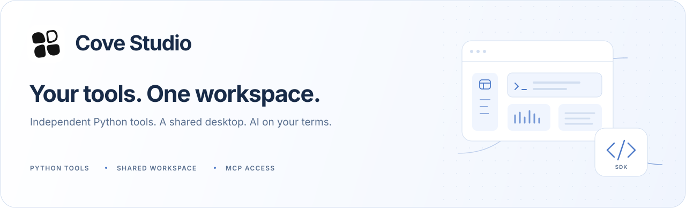
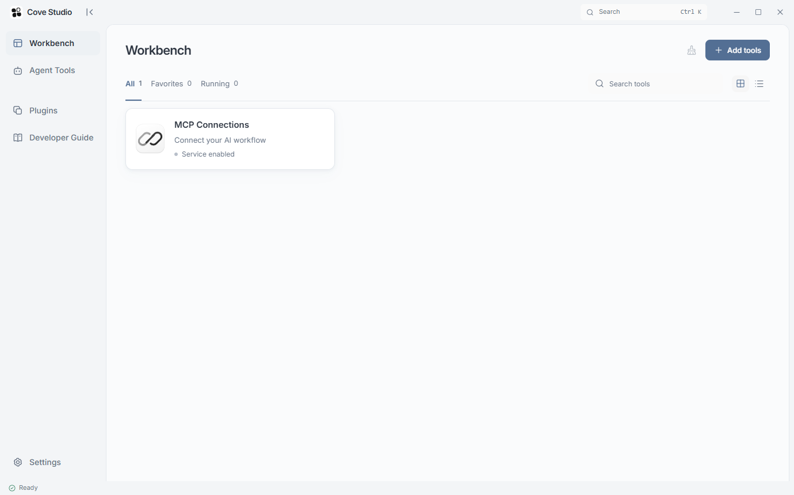
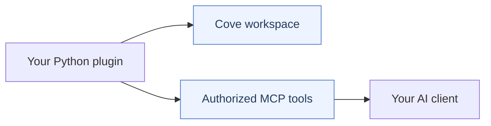

<picture>
  <source media="(prefers-color-scheme: dark)" srcset="docs/media/readme-hero-en-dark.svg" />
  
</picture>

<p align="center">
  <a href="LICENSE"></a>
  
  
  
</p>

<p align="center">
  <strong>English</strong> · <a href="README.zh-CN.md">简体中文</a>
  <br />
  <a href="#get-started">Get started</a> · <a href="docs/plugin-sdk.en.md">Plugin SDK</a> · <a href="docs/architecture.md">Architecture</a> · <a href="CONTRIBUTING.md">Contribute</a>
</p>

Cove Studio is an open-source Windows desktop workbench for independent Python tools. Keep tools open in persistent tabs, manage plugins in one place, and give your AI client access to the tools you choose.

**A small core, with room for your tools.** This repository contains the desktop host, SDK and disposable test fixtures. MCP is the only bundled plugin; business tools are developed and distributed in independent projects.

<picture>
  <source media="(prefers-color-scheme: dark)" srcset="docs/media/workbench-en-dark.png" />
  
</picture>

<p align="center"><sub>The core workbench, shown with its single built-in MCP service. Light and dark themes follow your preference.</sub></p>

## A workspace that stays out of your way

| Keep your work open | Bring your own tools | Connect your AI workflow |
| --- | --- | --- |
| Persistent tabs keep tool workspaces mounted as you navigate. | Python commands and a manifest use shared forms, results and task controls. | Share selected tools through MCP; confirm each write in Cove. |

- **One visual language.** Shared color schemes, light/dark themes and reduced-motion support.
- **Independent extensions.** A plugin owns its commands, data, optional sandboxed interface and translations; the host supplies the workspace and lifecycle controls.
- **Chinese and English.** Change the interface language immediately without closing tools or connections.

## Get started

### Run from source

You need **Windows**, **Python 3.11+**, **Node.js 22.12+** and **Microsoft Edge WebView2 Runtime**.

```powershell
git clone https://github.com/Sharanie0612/Cove-Studio.git
cd Cove-Studio
python -m venv .venv
.venv\Scripts\python.exe -m pip install -r requirements.txt
npm ci
npm run build
npm run desktop
```

For development, run `npm run dev` and `npm run desktop:dev` in separate terminals. Browser preview displays the interface; local commands require the desktop runtime.

To create a Windows installer, follow [Windows delivery](docs/windows-release.md). The build produces `artifacts/Cove-<version>-setup.exe`.

### Connect an AI client

1. Open **Workbench → MCP Connections** and follow your client's setup guide.
2. Choose the tools to share on the separate **Agent Tools** page and save authorization.
3. Reload Cove MCP in the client when instructed, then ask it to call `cove_tools`.

Cove provides setup profiles for **Codex · Claude Code · Cursor · DeepSeek Harness · ZCode · WorkBuddy · TRAE**. Accounts and models stay in the client. See [MCP setup and diagnostics](docs/harness-connections.md) for client-specific steps.

> **Check each stage:** saved configuration → online adapter → successful tool call.
>
> An empty tool catalog is expected until you install and authorize tools. Each write requires confirmation in Cove.

<details>
<summary>Connection controls and older adapters</summary>

Disconnect pauses new requests from that client while preserving its configuration and authorization. Running tasks finish. The connection page shows live adapter versions and flags older sessions. Reload Cove MCP in the client to update a session; adapters from before 0.12.4 need this before disconnect controls become available.

MCP is disableable and cannot be removed. Client setup and tool authorization remain separate workflows.

</details>

## Build your own tool

Open **Developer Guide** in Cove and download the self-contained Python starter. Declare your form, commands, results and optional AI tools in a manifest. Write the behavior in Python; the host renders the interface without a frontend build or registration change.



1. **Start with an example.** Run a command locally and inspect the result.
2. **Package and import.** Use the starter's doctor and packager, then import the `.cove-plugin` on the Plugins page.
3. **Share when ready.** Declare optional AI tools and choose their grants in Agent Tools.

The host provides isolated worker processes, compatibility checks, task controls and per-write approval. Workers run with the current user's permissions. See [the security model](SECURITY.md) for the trust boundary.

## Find your next step

| Resource | What you will find |
| --- | --- |
| [Plugin SDK](docs/plugin-sdk.en.md) | Manifests, Python commands, shared surfaces and AI tools |
| [Plugin-owned UI](docs/plugin-ui.md) | Self-contained interfaces, controlled commands and approval |
| [Architecture](docs/architecture.md) | Core modules, transport and plugin boundaries |
| [MCP connections](docs/harness-connections.md) | Client setup, authorization and connection diagnostics |
| [Localization](docs/localization.md) | Interface languages, plugin catalogs and translation rules |
| [Appearance](docs/appearance.md) | Shared color, typography and motion rules |
| [Contributing](CONTRIBUTING.md) | Development workflow, commit conventions and PR evidence |
| [Windows delivery](docs/windows-release.md) | Installers, frozen checks and disposable upgrades |

<details>
<summary>Languages, themes and plugin translations</summary>

Choose **Settings → Interface language** for Simplified Chinese or English. The choice takes effect immediately and is saved locally. First launch follows the system language where supported. The installer's language is independent of the app preference.

Plugins with declared message catalogs follow the interface language without restarting. Missing translations fall back to the original text. User data, existing results and executable examples keep their original content.

</details>

## Contribute

Contributions to the core, SDK, documentation and translations are welcome. Keep business tools in independent repositories so every extension can evolve on its own.

Start with [CONTRIBUTING.md](CONTRIBUTING.md) and [AGENTS.md](AGENTS.md). Run `npm run test:contribution` for documentation and PR conventions, and `npm run test:i18n` for translation checks. Product changes require the complete checks in the agent instructions. Source archives and installers enforce the same MCP-only boundary.

## Status and license

**Windows preview · MIT core and SDK · Unsigned installers.** Separate workers provide lifecycle isolation; they are not an operating-system sandbox. Source/build checks do not establish that every real client or device was tested.

Core and SDK use the [MIT license](LICENSE). Dependencies retain their own licenses and [third-party notices](THIRD-PARTY-NOTICES.md). Cove Studio is an independent project. See [SECURITY.md](SECURITY.md) for the security model and reporting guidance.
