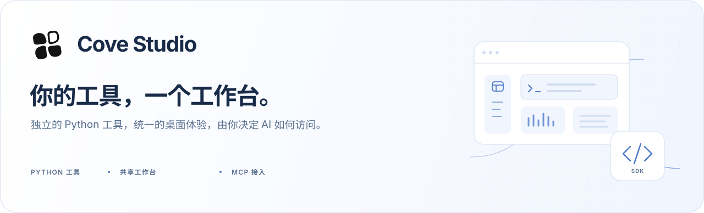
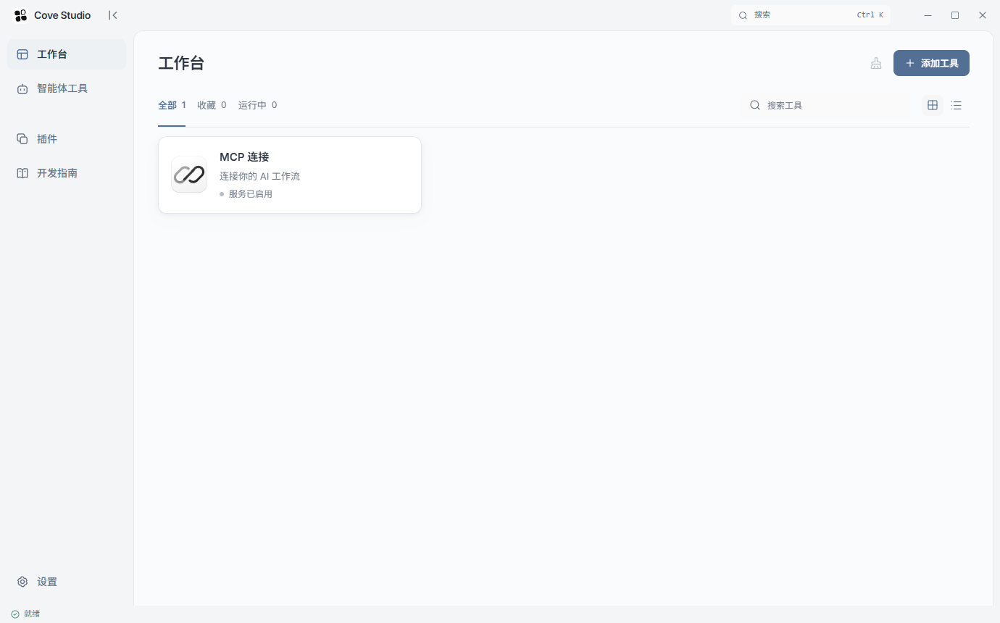
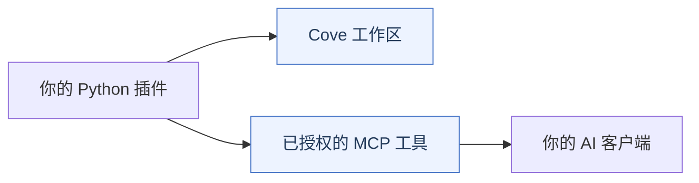

<picture>
  <source media="(prefers-color-scheme: dark)" srcset="docs/media/readme-hero-zh-dark.svg" />
  
</picture>

<p align="center">
  <a href="LICENSE"></a>
  
  
  
</p>

<p align="center">
  <a href="README.md">English</a> · <strong>简体中文</strong>
  <br />
  <a href="#开始使用">开始使用</a> · <a href="docs/plugin-sdk.md">插件 SDK</a> · <a href="docs/architecture.md">架构说明</a> · <a href="CONTRIBUTING.md">参与贡献</a>
</p>

Cove Studio 是面向独立 Python 工具的开源 Windows 桌面工作台。用持久标签保留工具工作区，集中管理插件，并让 AI 客户端访问你选择授权的工具。

**轻量的核心，为你的工具留出空间。** 本仓库包含桌面主程序、SDK 和一次性测试夹具，MCP 是唯一内置插件。业务工具由独立项目开发和分发。

<picture>
  <source media="(prefers-color-scheme: dark)" srcset="docs/media/workbench-dark.png" />
  
</picture>

<p align="center"><sub>仅包含 MCP 内置服务的核心工作台，支持浅色与深色主题。</sub></p>

## 工具各自独立，体验保持一致

| 工作区持续保留 | 用 Python 开发工具 | 接入你的 AI 工作流 |
| --- | --- | --- |
| 切换页面时保持工具挂载，在顶部标签间继续工作。 | 用清单与 Python 命令接入共享表单、结果视图和任务控件。 | 通过 MCP 共享选定工具，每次写操作都在 Cove 内确认。 |

- **统一的视觉体验。** 共享配色方案，支持浅色、深色和减少动态效果。
- **独立维护的扩展。** 插件负责命令、数据与翻译，主程序提供工作区和生命周期管理。
- **即时切换中英文。** 切换界面语言，不关闭工具或连接。

## 开始使用

### 从源码运行

需要 **Windows**、**Python 3.11+**、**Node.js 22.12+** 和 **Microsoft Edge WebView2 Runtime**。

```powershell
git clone https://github.com/Sharanie0612/Cove-Studio.git
cd Cove-Studio
python -m venv .venv
.venv\Scripts\python.exe -m pip install -r requirements.txt
npm ci
npm run build
npm run desktop
```

开发时在两个终端分别运行 `npm run dev` 和 `npm run desktop:dev`。浏览器可预览界面，本地命令需要桌面运行时。

需要 Windows 安装包时，按 [Windows 交付指南](docs/windows-release.md) 构建，产物为 `artifacts/Cove-<版本>-setup.exe`。

### 连接 AI 客户端

1. 打开**工作台 → MCP 连接**，按目标客户端的指南配置。
2. 在独立的**智能体工具**页面选择共享工具并保存授权。
3. 按提示在客户端重载 Cove MCP，再让客户端调用 `cove_tools`。

提供 **Codex · Claude Code · Cursor · DeepSeek Harness · ZCode · WorkBuddy · TRAE** 的配置方式。账号与模型由客户端管理，各客户端操作见 [MCP 接入与诊断](docs/harness-connections.md)。

> **逐步验证：**配置已保存 → 适配器在线 → 工具调用成功。
>
> 安装并授权工具前，工具目录为空是正常结果。每次写操作都需要在 Cove 内确认。

<details>
<summary>连接控制与旧版适配器</summary>

断开会暂停该客户端的新请求，保留配置与授权，正在执行的任务继续完成。连接页显示在线适配器的会话版本，并提示旧版本会话。在客户端重新加载 Cove MCP 即可更新会话；0.12.4 之前的适配器需要先重载，才能使用断开控制。

MCP 可停用、不可删除。客户端配置与工具授权分别管理。

</details>

## 开发自己的工具

打开 Cove 的**开发指南**，下载可独立运行的 Python 示例。通过清单声明表单、命令、结果和可选 AI 工具，在 Python 中实现行为；界面由主程序渲染，无需构建前端或修改核心注册代码。



1. **从示例开始。** 在本地运行命令，检查返回结果。
2. **检查、打包并导入。** 使用示例的诊断与打包脚本，在插件页导入 `.cove-plugin`。
3. **按需共享。** 声明可选 AI 工具，再在智能体工具页选择授权。

主程序提供独立 Worker、兼容性检查、任务控件和逐次写操作确认。Worker 使用当前用户权限运行，信任边界见[安全模型](SECURITY.md)。

## 文档导航

| 入口 | 内容 |
| --- | --- |
| [插件 SDK](docs/plugin-sdk.md) | 清单、Python 命令、共享界面与 AI 工具 |
| [架构说明](docs/architecture.md) | 核心模块、通信和插件边界 |
| [MCP 连接](docs/harness-connections.md) | 客户端配置、授权与连接诊断 |
| [多语言说明](docs/localization.md) | 界面语言、插件翻译目录与翻译约定 |
| [外观规范](docs/appearance.md) | 共享配色、字体与动态效果约定 |
| [贡献指南](CONTRIBUTING.md) | 开发流程、提交规范和 PR 验证证据 |
| [Windows 交付](docs/windows-release.md) | 安装包、冻结运行时与一次性升级验证 |

<details>
<summary>语言、主题与插件翻译</summary>

在**设置 → 界面语言**选择简体中文或英语，即时生效并保存到本机。首次运行按系统语言选择支持的语言。安装器语言与应用偏好独立。

提供翻译目录的插件随界面语言切换，不重启连接。缺少译文时回退原文。用户数据、已有结果与可执行示例保留原内容。

</details>

## 参与贡献

欢迎完善核心、SDK、文档与翻译。业务工具请在独立仓库中开发，让每个扩展都能独立演进。

先阅读 [CONTRIBUTING.md](CONTRIBUTING.md) 与 [AGENTS.md](AGENTS.md)。运行 `npm run test:contribution` 检查文档与 PR 约定，运行 `npm run test:i18n` 检查翻译。产品修改须完成代理说明中的完整验证。源码包与安装包采用同一条 MCP-only 边界。

## 状态与许可

**Windows 预览版 · 核心与 SDK 使用 MIT 许可 · 安装器尚未签名。** 独立进程提供生命周期隔离，不等于操作系统沙箱。源码或构建检查通过，不代表已验证所有真实客户端与设备。

核心与 SDK 使用 [MIT 许可证](LICENSE)；依赖保留各自许可与[第三方声明](THIRD-PARTY-NOTICES.md)。Cove Studio 是独立项目，安全模型和报告方式见 [SECURITY.md](SECURITY.md)。
