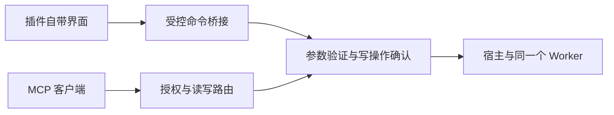

# Cove Studio 架构

核心提供通用桌面主程序、SDK、插件管理、工作区、授权与 MCP 桥接。MCP 是唯一内置插件。领域协议、专业界面、业务轮询、控制编排和业务翻译属于独立插件工程，不参与核心构建。

## 层与所有权

| 层 | 职责 |
| --- | --- |
| registry / manifest / contracts | 只读元数据、SDK 与 capability 兼容检查，不执行插件代码 |
| management / packages | 包预览、不可变导入票据、安装事务、解释器和启停 |
| host / runtime / worker | 宿主编排、每插件独立进程、有界 NDJSON 和命令分发 |
| plugin_framework | 执行期限、活动快照、私密持久化、诊断和可分发 SDK |
| views / WebSurface | 插件界面会话、隔离 iframe、白名单命令桥接、主题与语言同步 |
| assistance / mcp_bridge / protocol | 授权、参数验证、逐次写确认、同机网关和 STDIO |
| connections / client_backups | 客户端配置合并、精确备份、并发修改保护和撤销 |
| desktop / native_frame / maintenance | 原生窗口、活动保护、版本目录和安全安装升级 |

## 插件界面

共享 Form、Result、Job 和 Terminal 为常见工具提供声明式控件。专用界面通过 `ui.web` 自带静态 HTML/CSS/JavaScript，运行在没有同源权限的 iframe 中。核心不导入外部 React 模块，不在主窗口执行插件脚本，也不为具体工具添加渲染器分支。

界面会话绑定插件身份和清单修订。声明为只读的界面命令无需 AI 授权，写命令使用主窗口的单次确认。关闭界面、停用、停止、更新或清单变化使待执行操作失效。iframe 无法访问主窗口 DOM、原生桥接或其他插件；Python 插件仍以当前用户权限执行，进程隔离不等于 OS 沙箱。详细契约见 [plugin-ui.md](plugin-ui.md)。

主题、语言、减少动态效果、活动与连接状态通过消息同步，不通过主题切换重新加载界面。离开标签保留挂载状态，插件应暂停不必要的轮询。新增业务界面只发布插件，不要求核心前端登记组件。

## 生命周期与运行时

每个插件一个 Worker 和工作区。命令与事件使用结构化 JSON，协议读取有 UTF-8 字节上限；启动阶段也独立读取 SDK 回复。普通命令预算 20 秒，审批 180 秒、SDK 220 秒、总请求 245 秒、客户端配置 250 秒，集中于 policy.py。

退出、关标签、停止、重启、停用使用统一的连接、后台任务和执行中请求快照。运行环境更改和插件更新拒绝覆盖活动工作。SDK 后台任务提供合作式取消，不承诺业务回滚或进程退出后的恢复。

客户端到 STDIO 适配器、本机认证网关、实时授权和 Worker 的调用复用同一工具会话。配置已保存、适配器在线、真实工具调用是不同证据。MCP 可停用但不可移除，停用不会抹除共享选择或关闭其他业务 Worker。

## 交付与验证

源码归档使用显式白名单，核心审计同时检查内置插件、领域渲染器残留和构建资产。独立插件的源码与包不进入核心源码包、前端构建或安装包。只随 SDK 提供一次性通用示例。

Windows 使用版本目录，保留旧运行时和活动适配器。交付区分源码检查、冻结载荷、原生窗口、实际升级与真实设备证据。参见 [Windows delivery](windows-release.md)；原生框架检查不等于真实指针拖拽测试。
