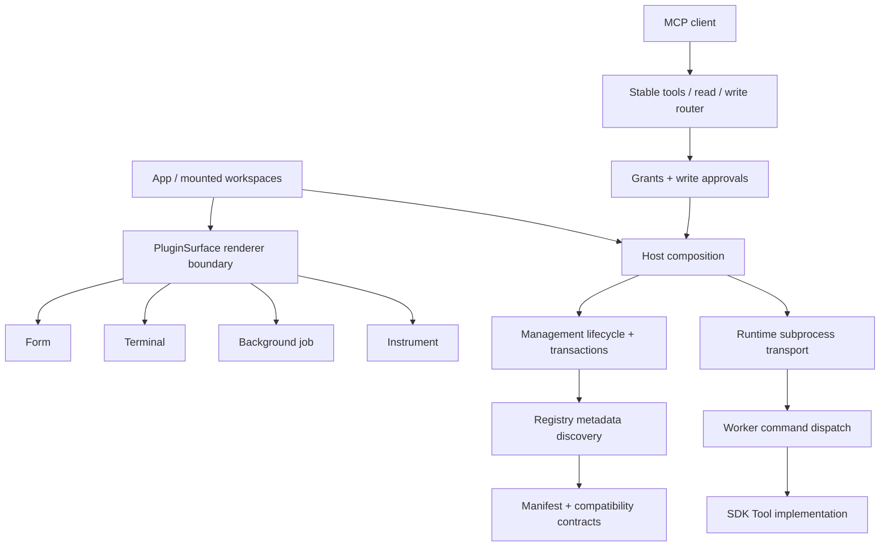
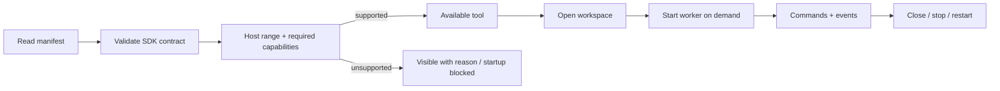

# Cove 架构

## 0.11 插件 UI 与业务边界

插件拥有命令实现、设备协议、输入校验、结果数据及资源释放。宿主拥有表单与结果布局、主题、可访问性、会话挂载、活动保护和 AI 审批。适配普通工具不需要向 App、工作区或前端注册表添加插件 id。需要新的领域 UI 时，先定义可复用契约与共享渲染器，再发布 capability。

`src/framework/contracts.ts` 定义共享 Surface 输入与声明式结果类型；`PluginSurface` 是唯一渲染器选择与异常隔离入口。FormSurface 消费普通数据键，TerminalSurface 负责终端呈现，JobSurface 消费任务快照。InstrumentSurface 仍是示波器式契约，设备专属 SCPI、型号检查和数据转换留在插件。

`ToolWorkspace` 只组合稳定挂载的 Surface 和工作区控件。`workspace/useWorkspaceSession` 负责命令与事件，`useWorkspaceConfiguration` 负责草稿和资料操作，`useWorkspaceOperation` 共享互斥状态，焦点与快捷键独立管理。配置、资料列表、确认与状态视图各自维护呈现。旧外部资料来源由 `profiles.ts` 适配。

仪器界面拆分为 `useInstrumentSession`（设备请求和队列）、`useInstrumentSettings`（尚未提交的设置）、波形显示、测量/截图、采集工具条和设置面板。采集阶段协调、草稿同步及波形坐标为实际 UI 使用的独立函数并有行为回归。停止或隐藏采集不卸载设备会话；轮询不覆盖编辑草稿。

`plugin_framework/result_contract.py` 与 JSON Schema 校验声明式布局，不执行插件代码。`plugin_framework/jobs.py` 提供可选 SDK helper，业务回调不依赖 UI；SDK 文件清单统一进入下载、冻结与独立分发。开发包同时包含最小命令、结构化结果和后台任务三个独立项目，每个项目可用 `python -S` 检查和打包。

Cove 提供可挂载的工作区、独立的 智能体工具授权和 MCP 客户端接入。MCP 是唯一预装插件，位于 plugins/projects/mcp。宿主不依赖业务插件的 Python 实现；具体工具在独立项目中开发和分发。

## 分层

| 层 | 入口与职责 |
| --- | --- |
| 桌面 | desktop_entry.py / toolbench.desktop：WebView、窗口、退出保护与应用生命周期 |
| 宿主 | toolbench.host：组合各服务、事件与请求路由 |
| 插件进程 | runtime.Worker：独立子进程、NDJSON 请求、超时、事件与资源释放；worker：子进程入口 |
| 版本与路径 | toolbench.__version__：宿主版本；paths：版本目录与安装根目录 |
| 插件管理 | management / packages / developer：扫描、导入票据、生命周期、打包与示例 |
| MCP 业务 | assistance：授权、参数快照、单次审批与审计 |
| MCP 传输 | mcp_bridge：同机认证桥接与客户端进程状态；protocol：标准 STDIO JSON-RPC |
| 客户端配置 | harness：各供应商契约；connections：合并、原文件备份、并发修改保护、撤销 |
| 独立分发 | distribution / plugin_mcp：同源码导出、只读工具注册、DSH overlay |
| SDK | sdk / manifest：插件上下文、命令错误与清单验证 |
| 界面 | src/App：导航与会话生命周期；各 Workspace 负责独立业务视图 |

toolbench 包名和现有 assistant_* 桥接方法保留，避免破坏 SDK 和旧桌面桥接调用；它们现在只管理 MCP，不包含模型请求或聊天。

## 运行边界

每个插件一个 Worker。普通操作走 Host → Worker → Tool，返回值与事件均为结构化 JSON。界面由宿主按清单统一渲染。活动任务声明和连接状态用于保护正在运行的工作。

MCP 客户端 → STDIO 适配器 → 本机认证网关 → 授权检查 → 参数校验 → 审批（仅写工具）→ 同一个 Worker。适配器不创建第二个工具会话。授权撤销立即使后续请求与待审批请求失效。

MCP 启用时，桌面启动即发布网关。STDIO 握手不依赖桌面在线，适配器轮询当前连接文件，桌面重启后重新注册。mcp-tools.json 仅缓存工具定义，离线时按 ai-tools.json 的授权过滤，不缓存调用结果或认证字段；所有调用仍必须通过在线网关。工具变化发送 list_changed；客户端可能缓存会话目录，更改共享后需重新加载 MCP。配置保存、适配器在线和实际调用审计是三个独立状态。

配置来源、版本校验与原子保存由独立工具实现，宿主仅渲染通用条目、来源标签、只读状态和撤销反馈。写入前应备份，撤销时比较修改后状态，避免覆盖外部新修改。

独立插件 → plugin_mcp → 相同 Tool 方法。它独立管理数据与生命周期，不继承桌面工具会话，仅注册开发者声明为只读的工具。readOnly 是契约声明，不是 Python 沙箱。

## 数据与分发

源码位于仓库，用户数据位于独立数据目录；导出插件排除数据、环境与开发运行文件。安装版唯一内置的 MCP 服务在 builtin-plugins 中，用户导入的包在外部目录。已有用户数据独立保留。

客户端配置修改只更新 Cove 项；写入前保存原始字节，保存和撤销均检查文件是否被其他程序修改。DSH 配置只做节点检查，不执行 YAML 中的 JavaScript 标签。

构建目录、旧截图、旧版本安装包和废弃插件资料不属于源码。clean_project.ps1 清理历史构建，保留当前安装包、插件包与精简验证证据。

MCP 是唯一预装内置插件，不能移除，可以停用。停用关闭网关、清空离线目录并取消待确认的操作；授权选择与其他独立 Worker 保留，已有工具会话不受影响。重启保持停用状态，启用时重新发布网关。

Windows 安装采用 versions/<版本号> 独立运行目录，快捷方式指向对应版本；MCP 客户端配置在连接中心更新，正在运行的旧适配器保留。跨版本升级不覆盖旧 EXE/DLL，保留旧桌面和外部客户端持有的适配器；相同构建按完整文件哈希复用，不触碰活动运行文件。仅对目标版本的不同文件执行占用保护。卸载仍检查所有版本的 Cove/Worker，运行时拒绝卸载，不终止进程。

## 0.8 核心边界

管理导航只包含工作台、智能体工具、插件与开发指南。MCP 与其他已打开的工作区在顶部标签栏挂载；切换管理页面只隐藏工作区，关闭、重启才结束其生命周期。智能体工具页面持有未保存草稿，轮询不会覆盖用户正在编辑的选择。共享状态轮询由 useAssistantState 复用。

安装根目录 plugins/ 为跨版本共用的投放目录：源码工程按子目录发现，插件包仍先预览再导入。原 data/installed 保持兼容。移除工程只操作其所属目录，用户数据单独保存。重扫不重启现有 Worker。内置 id 优先，不能被外部包覆盖。

Windows 标题栏超过移动阈值后仅发起一次原生 HTCAPTION 移动，Windows 负责捕获和释放。延迟到鼠标释放之后的请求会被忽略。最大化从 WinForms 当前状态切换，并使用当前显示器的工作区域；Resize 在 UI 线程同步状态，避免异步事件顺序导致按钮与窗口状态不一致。视图切换不重建窗口和终端。

native_frame 保留原生可调整窗口样式以支持左右吸附和顶部最大化，通过 WM_NCCALCSIZE 隐藏系统标题栏。最大化保留 Windows 的不可见调整边缘，将可见客户区限制在当前显示器工作区内，避免任务栏遮挡和内容裁切。实现遵循 [Windows 自定义边框规范](https://learn.microsoft.com/en-us/windows/win32/dwm/customframe)，回归检查同时检查样式、客户区坐标、最大化状态和真实拖拽。

图标仅保留 SVG 源、构建生成的 ICO 与 UI PNG；图案颜色为 #141414，保留原有几何。快捷方式使用版本目录 EXE 内嵌图标，升级按严格文件名匹配清理根目录旧图标。若 Explorer 映射导致无法删除，移动到 .cove-retired-icons 归档，避免重启系统进程。旧运行目录不清理，以免影响仍在运行的会话。

动效由 motion.css 定义公共时长和缓动，涵盖侧栏收放、卡片入场、悬停、标签和开关。系统 reduced-motion 会关闭非必要动画。

## 0.9 插件平台

- `contracts.py` 只依赖标准库，集中 SDK 版本、宿主能力和兼容范围；随开发示例和独立分发一起提供。
- `registry.py` 只读取元数据，不导入插件代码。扫描顺序为内置、旧托管目录、共享投放目录。内置 id 优先，冲突及损坏项目单独报告，退役项目和用户数据保留。
- `management.py` 拥有安装事务和启停策略，`host.py` 组合服务与分发调用，`runtime.py` 只管理进程/协议，不再反向导入宿主。
- `src/framework/PluginSurface.tsx` 集中选择延迟加载的渲染器，并为每个工具隔离渲染异常。业务命令仍走桥接；插件不能执行任意网页脚本。`pluginPresentation.ts` 集中工具状态、分类筛选与展示选择。
- `WorkbenchHome` 负责工具发现和会话总览，`WorkspaceTabs` 保持工具身份，`WorkbenchStatus` 展示真实运行状态。收藏和侧栏偏好使用既有持久状态钩子；会话连接不写入浏览器偏好。

### 兼容检查与生命周期

旧 SDK v1 清单不需要补字段。新的 `compatibility` 为可选声明，最低和最高版本均包含边界；未知能力可被解析，但会阻止安装和启动。已放入源码目录的不兼容项目仍展示原因，不会通过 AI 工具目录暴露。

管理锁串行化安装、重扫和生命周期修改，宿主锁保护目录和 Worker 映射，Worker 的请求锁保护协议队列；不要在持有宿主状态锁时等待慢速设备或用户确认。源码重扫不代表热替换正在运行的 Python 模块；变更业务实现后应显式重启相应插件。不得通过导航、换肤或刷新目录自动重建终端。

### 新增一种能力

1. 先扩展清单 Schema 和 `manifest.py` 语义校验，明确命令、参数、结果、事件、资源释放和错误码。
2. 在 SDK 或独立插件中实现业务，界面能力在 `PluginSurface` 注册共享渲染器；新的 `ui.*` 能力必须由宿主实现。
3. 在 `contracts.CAPABILITIES` 发布能力名称，插件声明最低宿主版本和依赖能力；新增可选字段应保持旧 v1 插件工作。
4. 验证旧插件、无依赖导出示例、损坏包与不兼容包、进程退出、页面切换、深色和 reduced-motion，再验证安装包。

当前仍是每个插件一个 Worker、一个工作区。多实例会话、任意 Web 前端和 OS 级沙箱尚未实现，不能仅靠增加 capability 名称声称支持。

### MCP 稳定入口

客户端只注册 `cove_tools`、`cove_read`、`cove_write`。`cove_tools` 按需发现当前授权插件及其完整参数 Schema；读写入口每次重新检查实时授权，写操作依然逐次审批。插件授权变化不改变顶层工具名，减少客户端重载压力。安装配置、适配器在线、真实调用结果仍是三层独立证据。

## 0.9.1 统一框架与验证

`toolbench/plugin_framework/` 集中执行期限、活动状态、脱敏诊断、内置服务标识和 SDK 文件清单。宿主编排、进程传输与桌面窗口仍保持各自模块，只调用框架策略。SDK 文件清单由源码示例、独立分发、冻结构建共享，避免新增模块漏打包。

`src/framework/` 集中工作区编排与生命周期说明，`surfaces/` 集中表单、终端、任务和仪器的共享部件，`profiles.ts` 处理旧外部配置来源。管理导航不包含具体业务插件判断。插件的专业业务和说明保留在独立插件项目；通用 SDK 文档继续描述扩展契约。

普通命令预算 20 秒，宿主等待按请求关联单独计时，审批 180 秒、SDK 220 秒、总请求 245 秒、可配置客户端 250 秒。构造阶段同样具备独立协议读取。停止、失败和超时撤销调用方审批；授权在实际执行前重新检查。

退出、关标签、停止、重启、停用共用连接/后台任务/执行中请求的活动快照。安装更新和运行环境切换拒绝覆盖活动工作。诊断不保留任意 stderr，仅保留结构化故障定位信息。

`tests/test_runtime_lifecycle.py` 通过真实子进程复现超过旧 20 秒期限、构造阶段 SDK 调用、审批与取消、异常退出和后台任务保护。`tests/ui/` 在真实 React 页面和真实本地 Host 上验证弹窗、焦点恢复、延迟加载、终端节点保活与启动失败恢复。`.github/workflows/checks.yml` 配置 Windows 自动检查、浏览器测试和冻结运行时检查；真实鼠标拖拽及历史安装器升级仍需交付机验证，不能由 reducer 测试替代。

## 0.10 产品布局

左侧保留管理导航，顶部只在工具打开后显示工作区标签。工作台使用全宽工具集合，提供全部、收藏、运行中筛选及持久的卡片/列表布局，最近使用跨启动保存。插件管理采用紧凑行式布局；说明、诊断与生命周期操作放入详情。AI 授权草稿独立保留，可直接进入客户端连接页；连接页分别展示已保存配置、在线适配器和真实工具调用结果。

慢速打开采用导航修订号：用户已切换页面时，只挂载完成的工作区，不覆盖更新的导航选择。标签和终端保持原有身份及生命周期。解释性文字放到悬停、详情和专门指南中，写操作确认、导入信任与数据影响仍明确展示。

## 0.10.1 公共行为与开发诊断

`plugin_framework/framing.py` 为桌面 Worker、Worker 输入和独立 MCP 共用的有界 NDJSON 读取器。按 UTF-8 字节计数，不含 LF/CRLF；MCP 输入 128 KiB，Worker 帧为 16 MiB 加 64 KiB 包装余量。超限终止相应传输会话，不把余下片段当作新请求执行；诊断仅记录结构化错误码和限额。SDK 模块清单自动包含这些标准库模块。

`plugin_framework/persistence.py` 集中原子字节、文本和 JSON 保存。私密目录先限制权限，再创建临时文件写入敏感内容；Windows 使用 owner/SYSTEM 受保护 DACL，并拒绝符号链接和目录联接。SDK 的 `atomic_json` 导入位置保持兼容。`client_backups.py` 只负责精确撤销记录的存储和保留，连接模块继续负责配置合并、修订校验和自动维护。清理失败不回滚成功的配置保存。

审批视图与日志摘要分离：审批列出全部非秘密参数并提供遮盖字段元数据，不再复用有损摘要。执行仍使用深拷贝参数，批准前后的授权、生命周期校验和取消机制保持不变。

前端 `AssistantStateStore` 提供单一、有响应节奏的状态读取。智能体工具、MCP 和全局审批共享快照；订阅和窗口可见性控制读取生命周期，修订号丢弃过时响应，修改后的刷新等待新快照。授权编辑草稿不由轮询覆盖。仪器高频采集继续保留自己的队列和节奏。通用工作区使用中立配置文案，外部来源差异仍由 framework profile adapter 处理。

